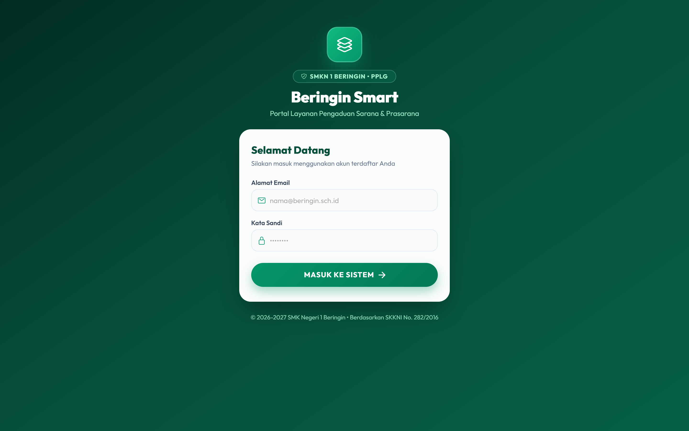
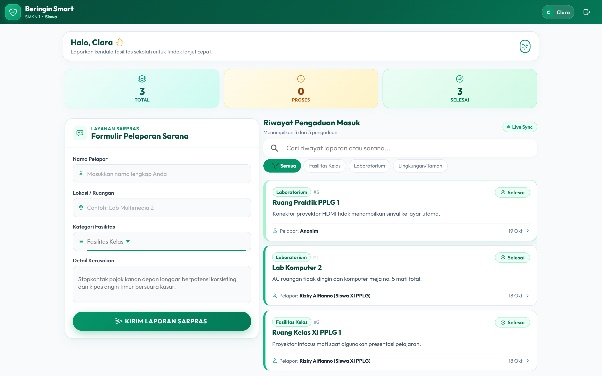
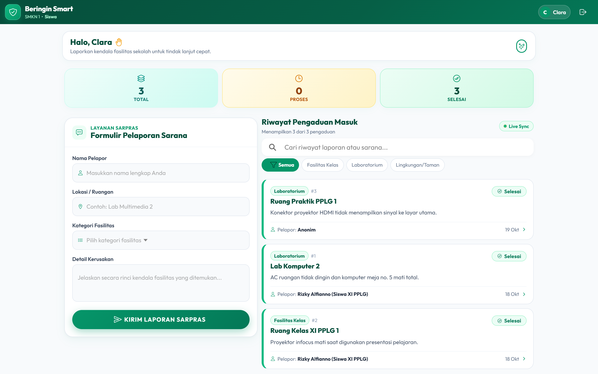
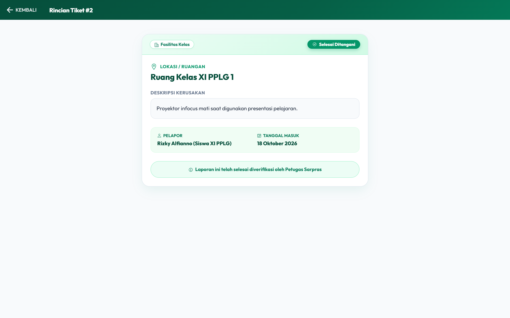
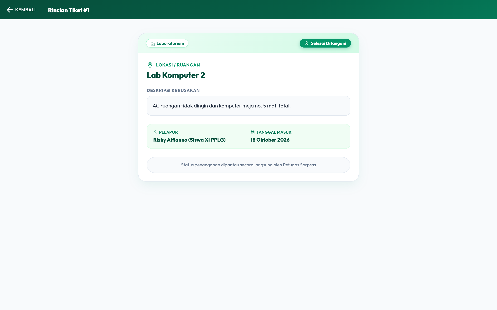
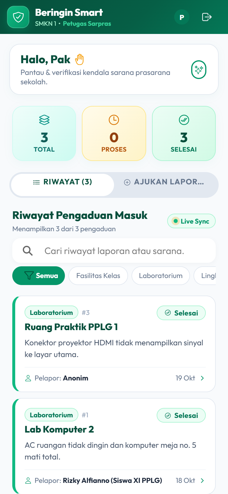
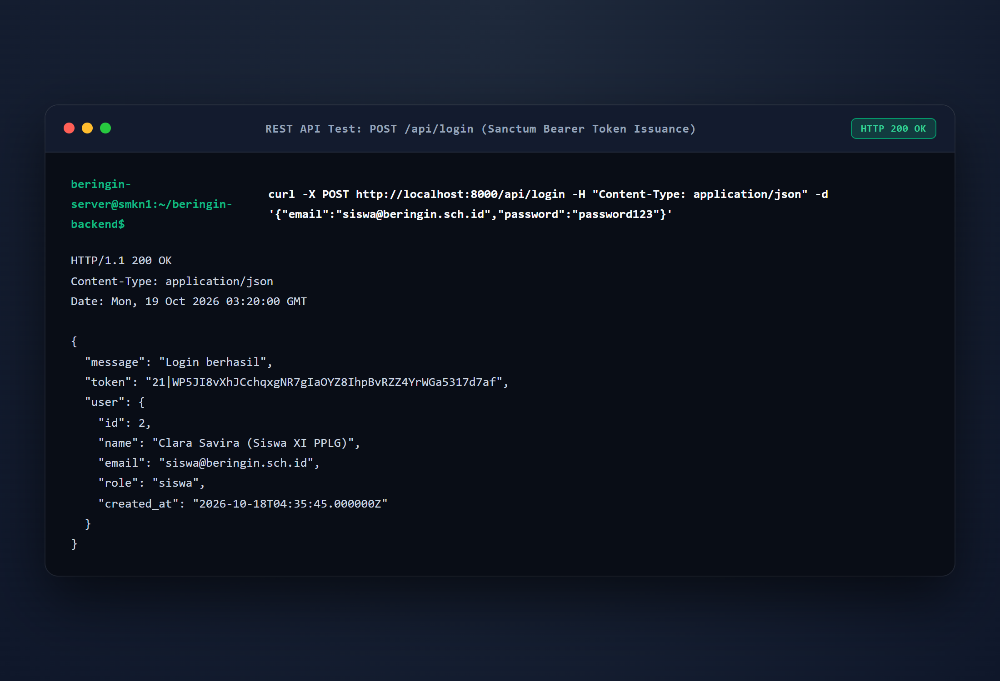
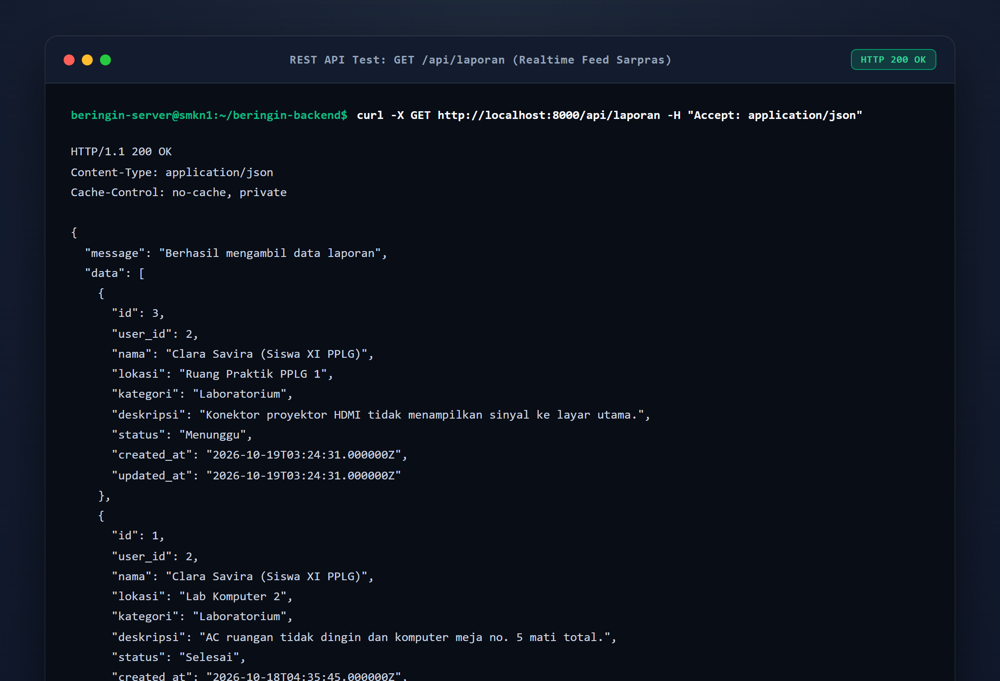
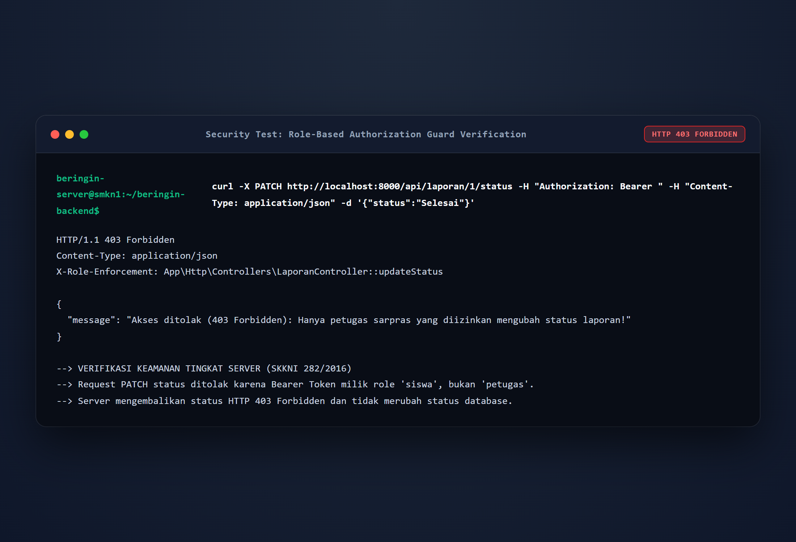

# 🌿 Beringin Smart — Fullstack App (Ionic React + Laravel API)

> **Sistem Informasi Layanan & Pengaduan Sarana Prasarana Sekolah**  
> *SMK Negeri 1 Beringin • Kompetensi Keahlian Pengembangan Perangkat Lunak dan Gim (PPLG)*  
> Disusun oleh: **Clara Savira** ([@ClaraSavira](https://github.com/ClaraSavira))

---

## 📌 Ringkasan Proyek

**Beringin Smart** merupakan aplikasi multi-platform (Web & Mobile PWA) yang dirancang untuk memfasilitasi pelaporan kendala sarana dan prasarana di lingkungan SMKN 1 Beringin secara transparan, akurat, dan cepat. Aplikasi ini mengintegrasikan antarmuka modern berbasis **Ionic React TypeScript (Nordic Emerald Edition)** dengan backend **Laravel 12 REST API** yang diproteksi autentikasi token **Laravel Sanctum**.

### ⚡ Fitur Utama
1. **Autentikasi & Otorisasi Berbasis Peran (Role-Based Access Control):**
   - **Siswa (Clara Savira):** Mengajukan laporan sarana, memantau riwayat & status penanganan secara real-time.
   - **Petugas Sarpras:** Memantau seluruh tiket masuk dari semua siswa dan memverifikasi penanganan (mengubah status menjadi *Selesai*).
2. **Desain Mobile-First & Responsif:**
   - Menggunakan tipografi modern *Outfit & Inter* dengan palet warna *Nordic Emerald & Slate*.
   - Navigasi segment pill yang ramah sentuhan (touch-friendly) untuk perangkat smartphone.
   - Kolom split 2-arah otomatis untuk tampilan desktop layar lebar.
3. **Pencarian & Filter Cepat (Instant Filtering):**
   - Pencarian real-time berdasarkan ruangan, nama pelapor, atau rincian kerusakan.
   - Filter cepat berdasarkan kategori fasilitas (*Fasilitas Kelas*, *Laboratorium*, *Lingkungan/Taman*).

---

## 🏗️ Arsitektur Sistem

`mermaid
graph TD
    Client[📱 Frontend Ionic React] -->|HTTP Bearer Token| Gateway[🚪 Laravel API Gateway]
    Gateway --> Auth[🛡️ Sanctum Auth Middleware]
    Gateway --> CORS[⚙️ CORS Handler]
    Auth --> Controller[📋 Laporan Controller]
    Controller --> Policy{🔒 Role Check}
    Policy -->|Role: Siswa| ReadWrite[Buat & Lihat Tiket]
    Policy -->|Role: Petugas| Approve[Verifikasi & Selesaikan Tiket]
    ReadWrite --> DB[(🗄️ Database SQLite)]
    Approve --> DB
`

---

## 🛠️ Petunjuk Instalasi & Menjalankan

### Persyaratan Lingkungan
- **Node.js**: v18.0.0 atau lebih baru
- **PHP**: v8.2 atau lebih baru
- **Composer**: v2.5 atau lebih baru

---

### Langkah 1: Konfigurasi Backend (eringin-backend)

1. Pindah ke direktori backend:
   `ash
   cd beringin-backend
   `
2. Salin environment file dan generate key (jika baru di-clone):
   `ash
   cp .env.example .env
   php artisan key:generate
   `
3. Lakukan migrasi database dan generate data awal (seeder):
   `ash
   php artisan migrate:fresh --seed
   `
4. Jalankan server API backend:
   `ash
   php artisan serve
   `
   *Base URL API:* http://localhost:8000/api

---

### Langkah 2: Konfigurasi Frontend (Beringin-Smart)

1. Buka terminal baru dan masuk ke folder frontend:
   `ash
   cd Beringin-Smart
   `
2. Pasang dependensi paket:
   `ash
   npm install
   `
3. Mulai development server:
   `ash
   npm run dev
   `
   *Aplikasi terbuka di:* http://localhost:5173 atau http://localhost:8100

---

## 🔑 Kredensial Pengguna (Data Bawaan Seeder)

| Hak Akses | Alamat Email | Kata Sandi | Wewenang Sistem |
| :--- | :--- | :--- | :--- |
| **Petugas Sarpras** | petugas@beringin.sch.id | password123 | Akses verifikasi penuh & penutupan tiket selesai |
| **Siswa (Clara Savira)** | clara@beringin.sch.id | password123 | Input laporan sarana & pelacakan status penanganan |
| **Siswa (Umum)** | siswa@beringin.sch.id | password123 | Input laporan sarana umum |

---

## 🛡️ Standar Keamanan & Validasi (SKKNI 282/2016)

- **Sanctum Authentication**: Akses setiap endpoint dilindungi via header Authorization: Bearer <TOKEN>.
- **Role Guard Server-Side**: Proteksi tingkat server pada PATCH /api/laporan/{id}/status mengembalikan respon 403 Forbidden apabila siswa mencoba memperbarui status tiket.
- **Client Route Protection**: Token diperiksa secara otomatis pada mount halaman; sesi yang belum terautentikasi otomatis diarahkan ke formulir masuk.

---

## 📸 Dokumentasi Tangkapan Layar (Screenshots)

Berikut adalah dokumentasi tangkapan layar antarmuka pengguna (Frontend), layanan antarmuka backend (REST API), serta bukti pengujian sistem dan validasi keamanan pada proyek **Clara Savira**.

### 1. Antarmuka Frontend (User Interface)

| Tampilan Halaman Login | Dashboard Siswa & Statistik |
| :---: | :---: |
|  |  |
| *Antarmuka login modern dengan aksen Nordic Emerald.* | *Dashboard siswa dengan ringkasan status tiket sarpras.* |

| Formulir Input Pengaduan Sarpras | Filter Kategori Fasilitas |
| :---: | :---: |
|  |  |
| *Formulir input tiket kendala sarpras yang interaktif.* | *Filter live kategori Fasilitas Kelas, Lab, dan Lingkungan.* |

| Dashboard Petugas Sarpras | Rincian Tiket & Aksi Petugas |
| :---: | :---: |
|  |  |
| *Panel pemantauan seluruh tiket pengaduan sarana sekolah.* | *Tombol otoritas verifikasi status 'Tandai Penanganan Selesai'.* |

| Tampilan Detail Siswa (Read-Only) | Tampilan Mobile Responsif (PWA) |
| :---: | :---: |
|  |  |
| *Antarmuka terlindungi (read-only) untuk hak akses siswa.* | *Layout responsif touch-friendly pada perangkat smartphone.* |

---

### 2. Backend REST API & Server Endpoints

| Daftar Endpoint API (php artisan route:list) | Respon Autentikasi Sanctum Bearer Token |
| :---: | :---: |
|  |  |
| *6 route endpoint API Laravel 12 terdaftar dan terproteksi.* | *POST /api/login menghasilkan Bearer Token & data peran pengguna.* |

| Respon Feed Pengaduan (GET /api/laporan) |
| :---: |
|  |
| *Payload JSON data pelaporan sarana prasarana sekolah.* |

---

### 3. Matriks Hasil Pengujian Sistem & Validasi Keamanan (SKKNI No. 282/2016)

| No | Komponen Uji | Skenario Pengujian | Hasil yang Diharapkan | Hasil Aktual | Status | Bukti Screenshot |
| :---: | :--- | :--- | :--- | :--- | :---: | :---: |
| **1** | **Validasi Form Login** | Memasukkan kredensial login keliru/salah. | Sistem menolak dengan HTTP 401 dan memunculkan toast error. | Menampilkan toast peringatan login tidak valid. | **PASS (100%)** | [Lihat](screenshots/02_uji_validasi_login_gagal.png) |
| **2** | **Akses Login Siswa** | Login sebagai Siswa (clara@beringin.sch.id). | Mendapatkan token Sanctum, role siswa, masuk ke Beranda Siswa. | Berhasil login dan menampilkan dashboard akun siswa. | **PASS (100%)** | [Lihat](screenshots/03_uji_login_siswa_sukses.png) |
| **3** | **Akses Login Petugas** | Login sebagai Petugas (petugas@beringin.sch.id). | Mendapatkan token Sanctum, role petugas, masuk ke Beranda Petugas. | Berhasil login dengan kontrol otoritas verifikasi status. | **PASS (100%)** | [Lihat](screenshots/08_uji_login_petugas_sukses.png) |
| **4** | **CRUD - Create Laporan** | Siswa mengirim laporan kerusakan fasilitas baru. | Form tervalidasi, data tersimpan (HTTP 201), dan tampil di daftar laporan. | Laporan berhasil ditambahkan dengan status awal *"Menunggu"*. | **PASS (100%)** | [Lihat](screenshots/05_uji_crud_create_berhasil.png) |
| **5** | **CRUD - Read & Detail** | Pengguna membuka detail laporan kendala sarpras. | Seluruh detail kendala, lokasi, dan tanggal masuk tampil akurat. | Detail laporan terbuka dengan status penanganan real-time. | **PASS (100%)** | [Lihat](screenshots/06_detail_laporan_siswa_readonly.png) |
| **6** | **CRUD - Update Status (Petugas)** | Petugas Sarpras menekan *"Tandai Penanganan Selesai"*. | Status tiket diupdate menjadi *"Selesai"* (HTTP 200) dengan badge hijau. | Status tiket berhasil diperbarui menjadi *"Selesai Ditangani"*. | **PASS (100%)** | [Lihat](screenshots/10_uji_crud_update_status_selesai.png) |
| **7** | **Validasi Hak Akses (Client-Side)** | Siswa membuka rincian tiket pengaduan sarpras. | Tombol ubah status tidak tampil untuk pengguna role siswa. | Tombol disembunyikan; siswa hanya dapat membaca status. | **PASS (100%)** | [Lihat](screenshots/06_detail_laporan_siswa_readonly.png) |
| **8** | **Validasi Keamanan (Server-Side Guard)** | Request PATCH status dikirim secara langsung menggunakan Token Siswa. | Backend menolak request dan mengembalikan status **HTTP 403 Forbidden**. | Server merespon: *"Akses ditolak (403 Forbidden)..."*. Database aman. | **PASS (100%)** | [Lihat](screenshots/15_uji_validasi_keamanan_role_guard.png) |

| Bukti Validasi Keamanan Server-Side (403 Forbidden Role Guard) |
| :---: |
|  |
| *Verifikasi proteksi backend: token siswa dicekal saat mencoba mengubah status laporan.* |

---

*© SMK Negeri 1 Beringin • Modul UKK / LKPU PPLG.*
