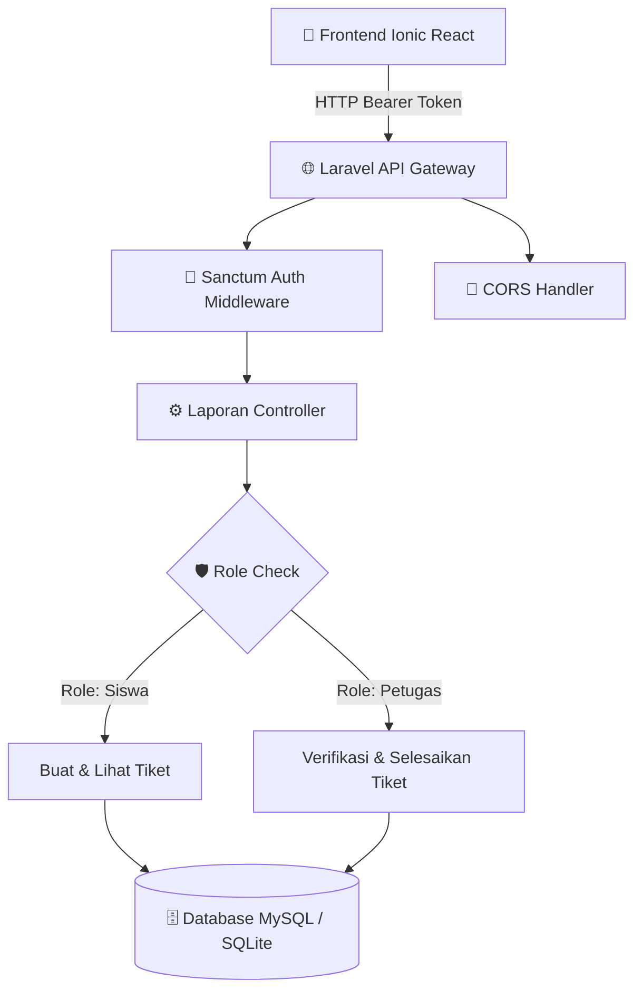

# 🌿 Beringin Smart

> **Sistem Informasi Layanan & Pengaduan Sarana Prasarana Sekolah**  
> *SMK Negeri 1 Beringin • Kompetensi Keahlian Pengembangan Perangkat Lunak dan Gim (PPLG)*  
> Disusun oleh: **Clara Savira** ([@ClaraSavira](https://github.com/ClaraSavira))

[](https://ionicframework.com/)
[](https://laravel.com/)
[](https://kemnaker.go.id/)

---

## 📌 Ringkasan Proyek

**Beringin Smart** merupakan aplikasi multi-platform (Web & Mobile PWA) yang dirancang untuk memfasilitasi pelaporan kendala sarana dan prasarana di lingkungan SMKN 1 Beringin secara transparan, akurat, dan cepat. Aplikasi ini mengintegrasikan antarmuka modern berbasis **Ionic React TypeScript** dengan backend **Laravel 12 REST API** yang diproteksi autentikasi token **Laravel Sanctum**.

### 🌟 Fitur Utama
1. **Autentikasi & Otorisasi Berbasis Peran (Role-Based Access Control)**
   - Siswa: Mengajukan laporan sarana, memantau riwayat & status penanganan secara real-time.
   - Petugas Sarpras: Memantau seluruh tiket masuk dari semua siswa dan memverifikasi penanganan (mengubah status menjadi *Selesai*).
2. **Desain Mobile-First & Responsif**
   - Menggunakan tipografi modern *Outfit & Inter* dengan palet warna *Nordic Emerald & Slate*.
   - Navigasi segment pill yang ramah sentuhan (touch-friendly) untuk perangkat smartphone.
   - Kolom split 2-arah otomatis untuk tampilan desktop layar lebar.
3. **Pencarian & Filter Cepat (Instant Filtering)**
   - Pencarian real-time berdasarkan ruangan, nama pelapor, atau rincian kerusakan.
   - Filter cepat berdasarkan kategori fasilitas (*Fasilitas Kelas*, *Laboratorium*, *Lingkungan/Taman*).

---

## 🏗️ Arsitektur Sistem



---

## ⚙️ Petunjuk Instalasi & Menjalankan

### Persyaratan Lingkungan
- **Node.js**: v18.0.0 atau lebih baru
- **PHP**: v8.2 atau lebih baru
- **Composer**: v2.5 atau lebih baru
- **Laragon / XAMPP / MySQL Server**

---

### Langkah 1: Konfigurasi Backend (`beringin-backend`)

1. Pindah ke direktori backend:
   ```bash
   cd beringin-backend
   ```
2. Salin environment file dan generate key (jika baru di-clone):
   ```bash
   cp .env.example .env
   php artisan key:generate
   ```
3. Lakukan migrasi database dan generate data awal (seeder):
   ```bash
   php artisan migrate:fresh --seed
   ```
4. Jalankan server API backend:
   ```bash
   php artisan serve
   ```
   *Base URL API:* `http://localhost:8000/api`

---

### Langkah 2: Konfigurasi Frontend (`Beringin-Smart`)

1. Buka terminal baru dan masuk ke folder frontend:
   ```bash
   cd Beringin-Smart
   ```
2. Pasang dependensi paket:
   ```bash
   npm install
   ```
3. Mulai development server:
   ```bash
   npm run dev
   ```
   *Aplikasi terbuka di:* `http://localhost:5173` atau `http://localhost:8100`

---

## 👥 Kredensial Pengguna (Data Bawaan Seeder)

| Hak Akses | Alamat Email | Kata Sandi | Wewenang Sistem |
| :--- | :--- | :--- | :--- |
| **Petugas Sarpras** | `petugas@beringin.sch.id` | `password123` | Akses verifikasi penuh & penutupan tiket selesai |
| **Siswa (Clara Savira)** | `clara@beringin.sch.id` | `password123` | Input laporan sarana & pelacakan status penanganan |
| **Siswa (Umum)** | `siswa@beringin.sch.id` | `password123` | Input laporan sarana umum |

---

## 🔒 Standar Keamanan & Validasi (SKKNI 282/2016)

- **Sanctum Authentication**: Akses setiap endpoint dilindungi via header `Authorization: Bearer <TOKEN>`.
- **Role Guard Server-Side**: Proteksi tingkat server pada `PATCH /api/laporan/{id}/status` mengembalikan respon `403 Forbidden` apabila siswa mencoba memperbarui status tiket.
- **Client Route Protection**: Token diperiksa secara otomatis pada mount halaman; sesi yang belum terautentikasi otomatis diarahkan ke formulir masuk.

---
*© 2026-2027 SMK Negeri 1 Beringin — Tugas Mandiri Integrasi Sistem Fullstack Mobile & Backend.*
